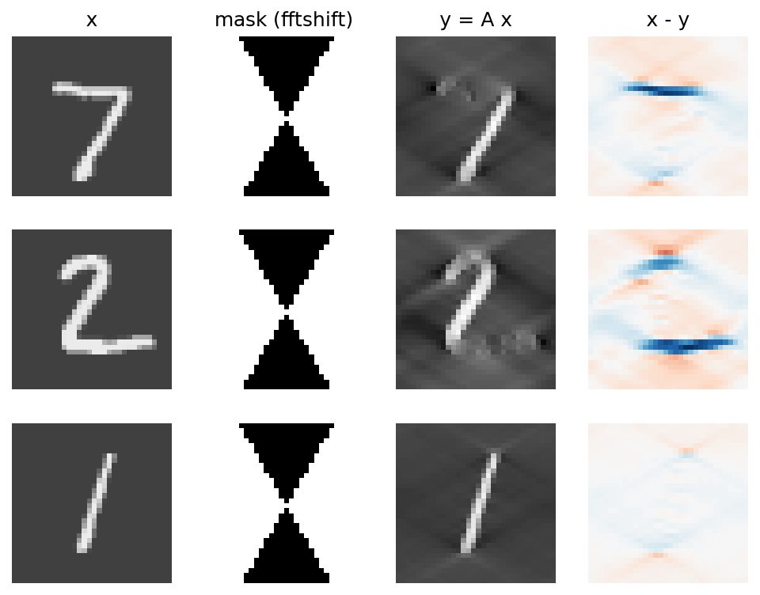
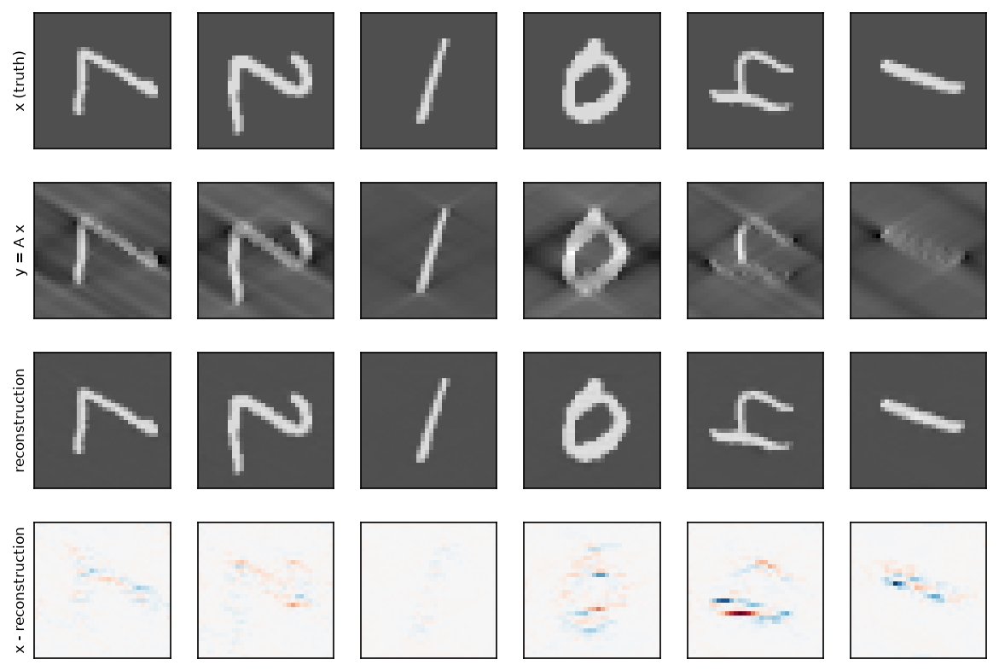

# missing-wedge-ei

A small PyTorch study of **equivariant imaging** on a toy version of the cryo-electron-tomography *missing wedge* problem. It is inspired by the equivariant imaging framework of Chen, Tachella and Davies (ICCV 2021). The setting here is much simpler than real cryo-ET: 2D images, no noise, MNIST digits.

**Status:** finished toy study. The operator, data loader, metrics, model and the four methods are implemented and tested; results over 3 seeds are reported below.

## The idea

We hide part of the information of an image in a precise way, then train a neural network to guess what was hidden. The question is whether this can be done **without ever showing the network a complete image**, using only the fact that a rotated digit is still a plausible digit.

## Where the problem comes from

In cryo-electron tomography, a microscope images a frozen biological sample from several angles, and a computation reconstructs a 3D volume. The sample cannot be tilted through all angles, so part of the information is never measured, and the reconstructed structures are distorted. This is the *missing wedge*.

In the real setting there is no complete "true" image to compare with. If there were, the microscope would not be needed. This is the motivation for methods that do not need ground truth.

## The toy version

The microscope is replaced by a fixed linear operator $A$, and the 3D volume by a 2D image $x$ of a handwritten digit (MNIST, padded to 32x32).

An image can be written as a sum of waves, and its Fourier transform says how much of each wave it contains. A wave has a size (frequency) and an orientation, given by a vector $(k_x, k_y)$. The operator $A$ removes all waves whose vector lies in a **double cone** of half-angle 30 degrees around the vertical frequency axis. It keeps every other wave, and it keeps the zero frequency, which is the mean brightness of the image. The measurement is $y = Ax$.

Properties, each covered by a test in `tests/`:
- $A$ is a projection: $A(Ax) = Ax$, because the mask contains only 0 and 1.
- The mask is symmetric ($M(-k) = M(k)$), so the output is real.
- The mean of the image is preserved.



*Three test digits. Columns: image x, Fourier mask (zero frequency at the centre), measurement y = Ax, and the part removed by A (x - y).*

## Why $A$ cannot simply be inverted

Two different images can give exactly the same measurement: it is enough that they differ only by waves inside the cone, which $A$ does not see. No formula can recover $x$ from $y$. Filling the cone requires a prior on what plausible images look like, and a neural network $f$ can learn such a prior.

## Goal

Train $f$ so that $\hat{x} = f(y)$ is close to $x$. Quality is measured by the PSNR (in dB, higher is better): $10\log_{10}(1/\mathrm{MSE})$, computed per image and then averaged. Gaining 3 dB corresponds to halving the error.

Because $A$ is an orthogonal projection, the squared error splits exactly into an error on the measured frequencies and an error inside the cone (`split_mse` in `metrics.py`). For a reconstruction that is consistent with the measurement, all of the error is in the cone, and this is the only part the network has to invent.

## Four methods

| Method | Loss | Needs complete images? |
|---|---|---|
| Baseline | none, $\hat{x} = y$ | no |
| Supervised | $\lVert f(y) - x \rVert^2$ | yes |
| Consistency only | $\lVert A f(y) - y \rVert^2$ | no |
| Equivariant | consistency + $\lVert f(y_2) - x_2 \rVert^2$ | no |

- **Baseline.** Does nothing. All of its error is in the cone. On the MNIST test set (10,000 images, 30-degree half-angle) it reaches **16.25 dB** (mean of per-image PSNR). The raw values are in `results/baseline.json`.
- **Supervised.** Learns from pairs $(y, x)$. This is not possible in the real setting, and it serves as an upper reference.
- **Consistency only.** A good reconstruction should give back $y$ when measured again. This is necessary but not sufficient: the identity map $\hat{x} = y$ already satisfies it, so the constraint says nothing about the cone.
- **Equivariant.** Assumes that the set of images is stable under 90-degree rotations. The network proposes $x_1 = f(y)$, which is rotated into $x_2$ and measured again with the same operator, giving $y_2 = A x_2$. The network must then recover $x_2$ from $y_2$. The cone is fixed but the image is rotated, so $y_2$ contains waves of $x_1$ that were inside the cone for $y$. To stay consistent on both $y$ and $y_2$, the network is pushed to fill the cone plausibly.

Digits in MNIST are all upright, so the rotation-stability assumption is false for the raw dataset. `data.py` therefore applies to each image a random number of quarter turns (0 to 3, fixed seed), which makes the dataset exactly stable under 90-degree rotation.

### The equivariant loss

Consistency alone ($\lVert A f(y) - y\rVert^2$) says nothing about the missing cone: the identity map $f(y)=y$ already satisfies it. The equivariant loss adds a second term that is, in effect, **supervised learning on targets built from the model's own output**. Let $x_1 = f(y)$, let $x_2 = g\,x_1$ with $g$ a 90° or 270° rotation, and let $y_2 = A x_2$:

$$L(\theta) = \lVert A f(y) - y\rVert^2 + \alpha\,\lVert f(y_2) - x_2\rVert^2 .$$

Rotating by $g$ moves the missing cone $C$ onto a different cone. The frequencies that $y$ showed (and that $x_1$ therefore contains as true content, when the consistency term is satisfied) land inside $C$ in $x_2$, which is exactly where $A$ hides them from $y_2$. The pair $(y_2, x_2)$ is thus a genuine "fill the missing cone" training example: the input lacks the content of $C$, while the target contains real, rotated, measured content there. If $f$ were perfect, $x_1 = x$ and this term would be plain supervised training on rotated images; in practice the targets are only contaminated by $f$'s own guesses inside the rotated cone, which $y_2$ keeps visible and $f$ can simply copy. Since $y$ and $y_2$ have the same format (an image with an empty cone), the same network learns to fill the cone of the real measurement. With `detach=True`, $x_2$ is treated as a constant pseudo-label.

This relies on the set of images being stable under 90° rotations (hence the random quarter-turns applied in `data.py`) and on the rotated cone not overlapping $C$ (half-angle below 45°). Rotations by 180° are not used: the mask is symmetric, so they reveal nothing new. The argument is a heuristic with no guarantee of exact recovery; whether it helps in practice is what the experiments below test.

## Research question

Without complete images, does equivariance bring anything over consistency alone, and how far is it from the supervised upper reference?

## Scope and limits

This is a 2D, noiseless toy on digits. It illustrates a mechanism and measures its empirical behaviour. It does not show that the method would work on real cryo-ET data, and it does not establish theoretical guarantees for exact recovery.

## Results

All numbers are PSNR in dB on the 10,000 MNIST test images (padded to 32x32, with the
fixed random quarter-turns of `data.py`), computed per image and then averaged. The
test set was evaluated once per final run. Mean ± sample standard deviation (n-1) over
3 seeds. The exact table is generated by `scripts/make_table.py` (`results/summary.md`).

| Method | Variant | Test PSNR (dB) |
|---|---|---|
| Baseline (x_hat = y) | none | 16.25 |
| Consistency only | direct | 16.29 ± 0.09 |
| Supervised | residual | 35.80 ± 0.47 |
| Equivariant (alpha = 3, detach) | residual | 34.34 ± 0.33 |

All methods use the same network (`ConvNet`, 28,353 parameters), the same data,
20 epochs, batch size 128, Adam with learning rate 3e-3. The last epoch is reported:
there is no checkpoint selection.



*First six test images: truth, measurement, equivariant reconstruction, error. The weights come from a re-run of the seed-0 equivariant configuration: training was not bit-for-bit reproducible, and that re-run reached 35.61 dB on the test set against 34.18 dB for the run reported in the table. The table uses the original runs only.*

### Observations

- The equivariant method gains 18.09 dB over the naive baseline on average; the
  seed-to-seed spread is 0.33 dB (sample standard deviation; the three seeds give
  34.18, 34.12 and 34.72 dB).
- Between 25% and 33% of the validation error of the equivariant
  method lies in the *measured* frequencies, where the baseline is exact by
  construction. The consistency term is not enforced exactly; a variant that imposes it
  by construction is a natural next step.
- With 5 epochs and one seed, `detach=True` (the rotated target is treated as a
  constant) beat `detach=False` by 4.4 to 5.9 dB, in
  both the direct and residual variants. Single seed, short runs: indicative only.
- With 5 epochs and one seed, alpha = 10 (27.27 dB) was clearly worse than alpha = 1
  (29.92 to 30.72 dB over 3 seeds). alpha = 0.3 (29.91 dB) fell at the low end of the
  alpha = 1 range, and alpha = 1 versus 3 (30.72 versus 30.76 dB) was within noise.
  alpha = 3 was kept.
- The learning rates 1e-3 and 3e-3 gave the same final validation PSNR at 20 epochs
  (34.14 and 34.15 dB, seed 0); 3e-3 was kept. In those two runs the largest
  epoch-to-epoch change over the last 5 epochs was 0.92 dB at 3e-3 and 1.73 dB at 1e-3.
  3e-4 had not converged after 20 epochs (31.74 dB, still rising).
- The validation PSNR of the equivariant final runs changes by up to 3.4 dB from one
  epoch to the next (5.3 dB for the supervised runs), so a single-epoch number carries
  that much noise.

### Questions and findings

| Question | Finding |
|---|---|
| Is supervised training the best method? | Yes in this setup: 35.80 ± 0.47 dB against 34.34 ± 0.33 dB for the equivariant method, about 1.5 dB higher. Every supervised seed (35.37 to 36.29 dB) is above every equivariant seed (34.12 to 34.72 dB). See the caveats in the Limitations. |
| Does consistency alone improve on the baseline? | No: 16.29 ± 0.09 dB against 16.25 dB, a gain of +0.04 ± 0.09 dB. |
| Does the equivariant loss improve on consistency alone? | Yes: 34.34 dB against 16.29 dB, about 18 dB higher. |
| How close does the equivariant method get to supervised training? | It recovers 18.09 dB of the 19.55 dB gain over the baseline obtained by supervised training (92.5%), without using complete images in its loss. |
| Does removing the random rotations of the data hurt the equivariant method? | Not tested. |

### Protocol notes

- The learning rate and alpha were tuned on the validation set for the equivariant
  method only. Tuning runs use seed 0 (alpha = 1 was also run with seeds 1 and 2 to
  gauge the noise). The other methods use the same learning rate without tuning.
- The effect of removing the random rotations of the data was not tested.

### Limitations

- This is a 2D toy on MNIST with no noise. It illustrates a mechanism and does not show
  that the method would work on real cryo-ET data. The wedge mask is the idealisation of
  a limited tilt range; a real acquisition is discrete, 3D and noisy.
- The validation PSNR compares with the true image, which would not exist in a real
  unsupervised setting; the equivariant and consistency methods are therefore slightly
  favoured when hyperparameters are chosen this way.
- The equivariant method also trains on rotated images. Its gain therefore mixes the
  equivariance principle and an augmentation effect; the two were not separated.
- The learning rate was not tuned for the supervised method.
- One small architecture (receptive field of 11 pixels). Conclusions are conditional on it.
- Only quarter-turn rotations are used (not uniform Haar rotations), and no theoretical
  recovery guarantee is claimed.

## Reproducing

```bash
uv sync
uv run pytest                                     # tests (downloads MNIST on first run)
uv run python scripts/baseline.py                 # baseline PSNR
uv run python scripts/run_experiments.py          # runs listed in RUNS (edit the file)
uv run python scripts/make_table.py               # results/summary.md
uv run python scripts/make_figure.py              # figures/reconstructions.png
```

Weights are written to `runs/` (ignored by Git); one JSON per run goes to `results/`.

## Reference

The method follows equivariant imaging: D. Chen, J. Tachella, M. E. Davies,
*Equivariant imaging: learning beyond the range space*, ICCV 2021. This repository is
an independent re-implementation on a toy problem, written for learning.
